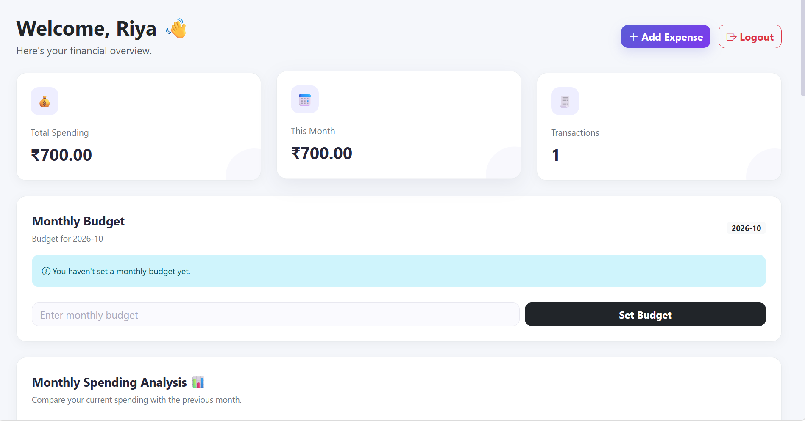

# Expense Tracker Web Application

A web-based Expense Tracker built using Python and Flask to help users record, manage, and analyze their daily expenses.

## Features

- User registration and login
- Session-based authentication
- Add, view, edit, and delete expenses
- Organize expenses by category
- Dashboard for expense tracking
- Monthly spending analysis and category-wise charts

## Tech Stack

- **Backend:** Python, Flask
- **Database:** SQLite
- **Frontend:** HTML, CSS, Bootstrap
- **Version Control:** Git and GitHub

## Project Structure

```text
expense-tracker-flask/
├── app.py
├── requirements.txt
├── static/
│   ├── css/
│   └── js/
├── templates/
│   ├── add_expense.html
│   ├── base.html
│   ├── dashboard.html
│   ├── edit_expense.html
│   ├── login.html
│   └── register.html
└── README.md
```

## Installation and Setup

### 1. Clone the repository

```bash
git clone https://github.com/RiyaTyagi07/expense-tracker-flask.git
cd expense-tracker-flask
```


### 2. Create a virtual environment

```bash
python -m venv venv
```

Activate it on Windows:

```powershell
.\venv\Scripts\Activate.ps1
```

### 3. Install dependencies

```bash
python -m pip install -r requirements.txt
```

### 4. Run the application

```bash
python app.py
```

Open the local URL shown in your terminal, usually `http://127.0.0.1:5000/`.

## Application Screenshot




## Database

The application uses SQLite to store expense records. Ensure the database is initialized according to the application's setup code before using the application.

## Security Note

This project is intended for learning and demonstration. Before production deployment, configure secure secret keys, password hashing, CSRF protection, and appropriate database and session security.

Do not upload passwords, secret keys, or personal financial data to GitHub.

## Future Improvements

- Monthly budget limits and alerts
- Export expense reports
- Improved mobile responsiveness
- Deployment to a hosting platform

## Author

**Riya Tyagi**

An academic project developed to practice Python, Flask, database operations, and web application development.
